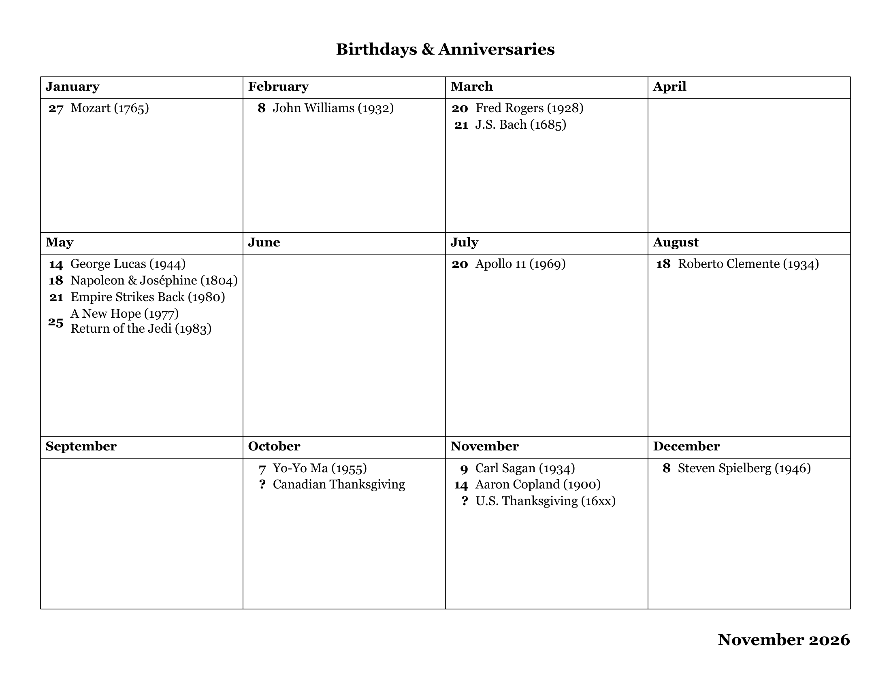

# Latex Template for a annual birthday, anniversary, and event calendar

I have created this Latex template to help manage a printable birthday calendar that is on our fridge.



The calendar takes a CSV input where each line is a person or event, in any order. Entries are sorted by day, and several entries on the same day share one day number.

I attemped to set up so the template finds the largest font size that fits every month on one page. Columns are always equal width. 

Added a paramter for other paper sizes: letter, A4, legal, tabloid or a custom size, in portrait or landscape.

The grid can be manually set to 4×3, 3×4, 2×6 or 6×2. There is also a `columns = auto` picks whichever grid allows the largest text.

Month order can be altared or allow for other languages. The order can be changed so the months are down the columns (Jan–Mar in column 1) or across the rows (Jan–Apr in row 1). The month names can be overriden with 

If you're not sure about the day of month for whatever reason, use a `?` as the day. Those entries are listed at the end of their month.

Headers and footers, left, centre and right slots at the top and bottom, plus a title.

Various defaut Styling features are here right out of the box. Bold day numbers, spacing, rules, fonts and month names can all be changed.

## Requirements

Speficially needs **LuaLaTeX.** 

**LaTeX packages:** `fontspec`, `geometry`, `pgf`/TikZ, `anyfontsize`, `datetime` (with `fmtcount`) and `iftex`. These are all included in a full TeX Live install. MiKTeX installs them on first use.

**Optional:** the Georgia font (It's become a personal favorite for some reason). If Georgia isn't installed, the template uses TeX Gyre Pagella instead.

## Files

| File | What it is |
|---|---|
| `birthdays.tex` | The document you compile, and where the settings live |
| `birthdays.csv` | Your dates |
| `birthdaycal.sty` | The Style File |
| `birthdaycal.lua` | Reads and sorts the CSV |

## The data file

```csv
month,day,event
3,5,Sean (1990)
Mar,17,Patrick O'Neil (1985)
5,4,Mandy Harrop (1989)
5,4,Mr. & Mrs. Harrop (1985)
11,?,Zoe
```

| Column | Accepts |
|---|---|
| `month` | `1`–`12`, or a name or abbreviation (`Mar`, `March`) |
| `day` | `1`–`31`, or `?` if you're not sure. `?` entries go at the end of the month, grouped together. |
| `event` | Any text. Write the year in parentheses yourself, e.g. `Sean (1990)`, or use the optional 4th column. |
| `year` *(optional)* | If present, it's added as ` (year)`. Free text, so `198x` or `1966?` are fine. |

- Order doesn't matter.
- Lines starting with `#` are comments. Blank lines are ignored.
- The header row is optional.
- Wrap a field in `"double quotes"` if it contains a comma.
- Characters such as `& % $ # _` are escaped for you, so `Mr. & Mrs. Smith` will be read from the csv file as is. 

## Settings

### Page size

Page size is set with the `geometry` line in `birthdays.tex`:

```latex
\usepackage[letterpaper, landscape, margin=0.5in]{geometry}
% a4paper, portrait, margin=12mm
% paperwidth=17in, paperheight=11in, margin=0.5in
```

### Layout options

Everything else goes in `\BDsetup{...}`:

```latex
\BDsetup{
  data      = birthdays.csv,
  columns   = 4,
  order     = vertical,
  bold days = true,
  title     = {Birthdays \& Anniversaries},
}
```

To change settings for one run only, put them in the optional argument: `\BirthdayCalendar[order=horizontal, columns=3]`.

#### Grid and order

| Key | Default | Values / meaning |
|---|---|---|
| `columns` | `4` | `2`, `3`, `4`, `6`, or `auto` (picks the grid that allows the largest text) |
| `order` | `vertical` | `vertical`: Jan, Feb, Mar run down column 1. `horizontal`: Jan–Apr run across row 1. |
| `header` | `separate` | `separate`: the month name has its own ruled cell. `inline`: the month name sits at the top of the month's cell. |
| `header font` | `\bfseries` | Style of the month names |
| `month names` | English | Comma list of 12 names, e.g. `{janvier,février,...}` |
| `fill` | `true` | Stretch rows to fill the page height |
| `line width` | `0.6pt` | Grid line thickness |

#### Text size

| Key | Default | Values / meaning |
|---|---|---|
| `max font size` | `24pt` | Upper limit for the automatic text size |
| `min font size` | `5pt` | Lower limit. You get a warning if the calendar can't fit even at this size. |
| `wrap` | `false` | `false`: largest size at which no name has to wrap. If that can't fit, wrapping is allowed automatically. `true`: allow wrapping for bigger text. |
| `line spacing` | `1.2` | Baseline skip as a multiple of the font size |

#### Days and spacing

| Key | Default | Values / meaning |
|---|---|---|
| `bold days` | `false` | Bold day numbers |
| `day font` | *(none)* | Any other styling for the day numbers, e.g. `\itshape` |
| `day align` | `center` | `center`: the day number is centred beside all its names. `top`: the day number sits beside the first name only. |
| `group sep` | `0.25em` | Extra space between different days |
| `name sep` | `0pt` | Extra space between names on the same day |

#### Title, header and footer styling

| Key | Default | Values / meaning |
|---|---|---|
| `title` | *(none)* | Title text. It becomes the centre of the header row unless `\chead` is set. |
| `title font` | `\bfseries\Large` | Style of the title. The header and footer use it too, unless overridden. |
| `head font` / `foot font` | same as `title font` | Style of the header / footer, e.g. `\small\itshape` |
| `head rule` / `foot rule` | `0pt` | Thickness of a line under the header / above the footer |
| `head sep` / `foot sep` | `1em` | Gap between the calendar and the header / footer |

### Headers and footers

The commands have the same names as in `fancyhdr`. Don't load `fancyhdr` as well.

```latex
\lhead{Grogan Family}      \chead{}             \rhead{}
\lfoot{Sean Grogan, PhD}   \cfoot{\thepage}     \rfoot{\FooterDate\today}
```

- Slots you leave empty take no space. When you do use a header or footer, the calendar shrinks to make room.
- The centre slot is truly centred, whatever is on the left and right.
- Use `\\` inside a slot for more than one line.

### Dates

Date formatting comes from the [`datetime`](https://ctan.org/pkg/datetime) package. Define a format once in the preamble, then use it for today's date or any other date:

```latex
\newdateformat{FooterDate}{\monthname[\THEMONTH] \THEYEAR}
\newdateformat{ISODate}{\THEYEAR-\twodigit{\THEMONTH}-\twodigit{\THEDAY}}

\FooterDate\today                    % November 2026
\ISODate\today                       % 2026-11-02
\FooterDate\formatdate{5}{3}{1990}   % March 1990  (day, month, year)
```

The pieces you can use in a format are `\THEDAY`, `\THEMONTH`, `\THEYEAR`, `\monthname[n]`, `\shortmonthname[n]`, `\twodigit{n}` and `\ordinal{n}`.

### Font

The font is set in `birthdays.tex` with `fontspec`. Any installed font works:

```latex
\setmainfont{Georgia}
```
